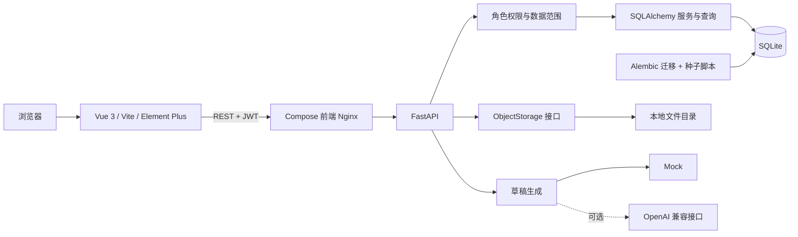
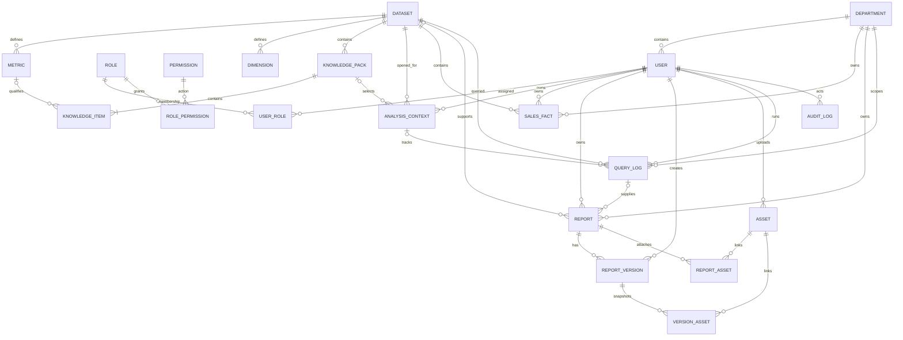

# LensBrief · 迷你 ChatBI 报告中心

LensBrief 是一个面向运动相机销售复盘的全栈作品。分析师可以在个人上下文中引用场景知识包，查询指标、生成草稿、挂载附件、发布和回滚。历史版本保留查询结果、引用的知识包版本、附件和回滚来源。项目以影石 Insta360 DataAgent 全栈开发实习生岗位为参考。销售数据、产品和演示账号均为虚构。

## 启动

安装 Docker Engine 与 Docker Compose，在根目录运行：

```sh
docker compose up --build -d --wait
```

- 工作台  [http://localhost:8080](http://localhost:8080)
- Swagger  [http://localhost:8080/api/docs](http://localhost:8080/api/docs)
- OpenAPI JSON  [http://localhost:8080/api/openapi.json](http://localhost:8080/api/openapi.json)
- 停止服务  `docker compose down`。命名卷保留数据库和附件。

容器启动时执行 Alembic 迁移与幂等种子脚本。首次构建需要拉取镜像和依赖。构建后，默认 Mock 模式可离线走完全部业务流程。

### Windows 本地启动

准备 Python 3.13、Node.js 22、PowerShell 7.3 以上，在仓库根目录运行 `pwsh -File .\start.ps1`。脚本安装依赖、构建 Vue、执行迁移和播种，再启动带前端静态文件的 FastAPI。默认在 `D:\CodexWork\cache` 和 `D:\CodexWork\temp` 保存缓存和临时文件，可用 `-CacheRoot` 与 `-TempRoot` 修改。用 `-Port 8081` 可更改端口。

| 演示账号 | 部门 | 权限范围 |
| --- | --- | --- |
| `analyst` | 华东运营 | 本人 |
| `manager` | 华东运营 | 部门 |
| `overseas` | 海外运营 | 本人，用于验证跨部门 403 |
| `admin` | 华东运营 | 全部，可分配角色和查看审计 |

密码均为 `LensBrief2026!`，登录页支持一键填入。样例销售数据覆盖 2026-10-01 至 2026-10-31。

[五分钟演示](docs/demo-5min.md) · [手写接口说明](docs/api.md) · [CSV 样例](docs/sample-sales.csv)

## 架构



`frontend/src/views` 包含页面，`backend/app/api` 包含资源路由与应用逻辑，`backend/app/models.py` 定义 SQLAlchemy 表，`backend/migrations` 保存迁移，`backend/scripts` 提供种子和基准。

### ER 图



`report_version` 的主键为 `(report_id, number)`。`report.current_version` 与 `report_version.restored_from` 均通过复合外键指向同一报告下的版本。版本保存标题、摘要、正文、聚合结果和附件快照。工作稿附件与历史版本附件独立维护。

### 版本、权限和文件

- 首次发布将草稿转为已发布。编辑已发布报告只更新工作稿，再次发布才产生新版本。归档后保留可读历史，删除为软删除。
- 回滚会新建一个发布版本，并恢复正文和附件。发布与回滚使用 `BEGIN IMMEDIATE` 串行化 SQLite 写事务，一次提交保存版本、附件关系、报告指针和审计。
- JWT 有效期 8 小时，密码使用 Argon2 哈希。服务端每次请求读取有效角色。越权返回 403 并单独写入审计。
- 查询先按本人、部门或全部过滤事实表，再做聚合。查询记录还要满足当前有效的数据范围。报告可引用所有者的本人查询或归属部门的部门查询，避免通过部门报告曝光全范围快照。
- 附件预览和下载校验报告或指定版本的权限。支持 PNG、JPEG、未加密 PDF 和 UTF-8 CSV。CSV 返回总行数，展示前 100 行。

### 场景知识包与分析上下文

- 管理员可新建和编辑场景知识包。每个知识包属于一个数据集，包含通用口径或只适用于指定指标的条目。编辑会递增知识包版本。
- 分析师可以在「分析上下文」保存分析目标、数据集与选用的知识包，并从上下文发起报告查询。归档会保留查询历史，恢复后可继续执行查询。上下文与归属关系对本人可见。
- 查询执行时复制知识包标题、版本和匹配条目。生成草稿使用该查询保存的引用，已发布报告可以展开查看来源。新查询使用知识包当前版本。
- 从初版升级时继续运行 `docker compose up --build -d --wait` 或原有 Windows 脚本。Alembic 会升级现有数据库，种子脚本补齐「渠道销售复盘」和「退款风险排查」知识包。

## 可选模型

默认使用 `LENSBRIEF_DRAFT_MODE=mock`。使用真实模型时，将 `.env.example` 复制为 `.env` 并设置下列变量。Windows 本地方案在 PowerShell 会话设置同名环境变量。

| 变量 | 值 |
| --- | --- |
| `LENSBRIEF_DRAFT_MODE` | `llm` |
| `LENSBRIEF_MODEL_URL` | 供应商提供的 API 基础地址，如 `https://…/v1` |
| `LENSBRIEF_MODEL` | 模型 ID |
| `LENSBRIEF_MODEL_KEY` | 模型密钥 |
| `LENSBRIEF_JWT_SECRET` | 本地示例之外使用至少 32 字节的随机值 |

模型请求经 `/chat/completions` 发送分析目标、权限过滤后的聚合结果与显式选用的知识条目。草稿输出经过结构校验，由用户保存和发布。

## 测试

```sh
python -m pip install -r backend/requirements.txt
python -m pytest backend/tests -q
cd frontend
npm ci
npm test
npm run build
npx playwright install chromium
npm run test:browser
```

Windows 本地脚本创建的 Python 在 `.venv\Scripts\python.exe`。Playwright 默认访问 8080 上已启动的工作台，可通过 `LENSBRIEF_BASE_URL` 指定地址，或用 `LENSBRIEF_BROWSER=msedge` 复用系统 Edge。浏览器测试会写入一条测试报告。

本地实测通过 pytest 29 项、Vitest 4 项与 Playwright 2 条完整流程。Windows 一键启动与 Vite 生产构建也已验证。pytest 输出一条 Starlette 测试客户端弃用提示。仓库的 Verify 工作流在 Linux 上构建 Compose 服务，并运行两条浏览器流程。

后端覆盖跨范围 403、分页边界、事务回滚、并发版本编号、版本恢复、非法状态流转、文件校验与预览、查询范围和日志。Vitest 覆盖筛选、分页重置与权限入口，浏览器测试验证真实的前后端流程。

## 索引与分页基准

| 索引 | 对应查询 |
| --- | --- |
| `ix_report_live_updated_id` | 全部范围报告列表，按更新时间和 ID 倒序。 |
| `ix_report_live_status_updated_id` | 全部范围报告的状态筛选和同一排序。 |
| `ix_report_live_owner_updated_id` | 本人报告列表按所有者过滤和同一排序。 |
| `ix_report_live_department_updated_id` | 部门报告列表按归属部门过滤和同一排序。 |
| `ix_query_created_id` | 查询历史按执行时间范围筛选和倒序分页。 |
| `ix_query_user_created_id` | 按用户和时间筛选查询历史。 |
| `ix_query_department_created_id` | 部门范围查询历史和时间筛选。 |
| `ix_query_context_created_id` | 单个上下文的查询历史和时间筛选。 |
| `ix_context_owner_updated` | 当前用户的上下文按更新时间和 ID 倒序。 |
| `ix_knowledge_dataset_id` | 知识包按数据集筛选并按 ID 分页。 |
| `ix_sales_dataset_day` | 单数据集的日期范围聚合。 |
| `ix_audit_created_id` | 操作审计按时间倒序分页。 |

报告使用部分索引，只覆盖未软删除的记录。关键字在标题和摘要中做子串匹配。

```sh
python -m backend.scripts.benchmark
```

Windows 可加 `--temp-dir D:\CodexWork\temp`。脚本用正式迁移创建独立数据库，生成 10,000 条报告。每组预热 10 次，采样 100 次，每页 20 条。计时包括列表、总数查询和 SQLAlchemy 行映射，采用最近秩法计算百分位。测试对象是本机单进程 SQLite 热缓存查询。查看 [原始样本](docs/benchmarks/samples.csv) 和 [环境与查询计划](docs/benchmarks/summary.json)。

| 查询 | Offset | P50（ms） | P95（ms） |
| --- | ---: | ---: | ---: |
| 全部范围首页 | 0 | 0.4439 | 0.5280 |
| 全部范围深分页 | 9000 | 1.4691 | 1.7336 |
| 已发布状态首页 | 0 | 0.3996 | 0.4850 |
| 已发布状态深分页 | 3000 | 0.8869 | 1.4616 |
| 标题／摘要关键字首页 | 0 | 5.5625 | 6.1546 |

## 已知限制

- 单机本地开发环境。SQLite 写入串行，列表使用 `limit/offset`，并发写入可能使记录在连续翻页时移动。表单采用最后一次保存为准。
- 演示账号和默认 JWT 密钥用于本地启动，服务默认绑定回环地址。JWT 保存在浏览器会话存储中。
- 数据目录包含一个合成销售数据集。查询使用预设指标和维度，知识条目按所选包和指标匹配。向量检索和自然语言生成 SQL 未实现。旧知识版本保存在引用它的查询和报告快照中。
- 存储层实现本地目录并预留 S3 兼容适配点。未提交的上传和软删除报告所关联的文件会保留，当前无清理任务。
- PDF 使用浏览器预览组件。真实模型需要供应商配置，离线 Mock 可复现草稿。线上模型调用需要相应的密钥和网络。
- FastAPI 的 Swagger UI 默认从 CDN 加载界面资源，OpenAPI JSON 可直接离线读取。
